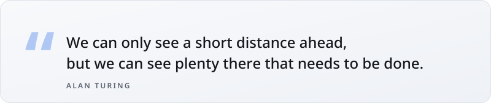
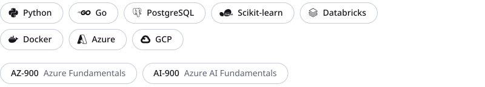
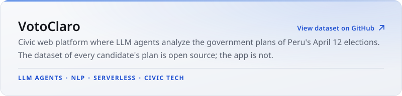
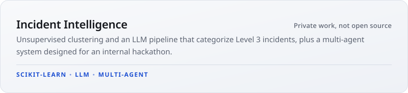

<picture>
  <source media="(max-width: 600px) and (prefers-color-scheme: dark)" srcset="assets/v0.5/m/hero_dark.svg">
  <source media="(max-width: 600px)" srcset="assets/v0.5/m/hero_light.svg">
  <source media="(prefers-color-scheme: dark)" srcset="assets/v0.5/hero_dark.svg">
  
</picture>

<picture>
  <source media="(max-width: 600px) and (prefers-color-scheme: dark)" srcset="assets/v0.5/m/quote_dark.svg">
  <source media="(max-width: 600px)" srcset="assets/v0.5/m/quote_light.svg">
  <source media="(prefers-color-scheme: dark)" srcset="assets/v0.5/quote_dark.svg">
  
</picture>

<h3><picture>
  <source media="(max-width: 600px) and (prefers-color-scheme: dark)" srcset="assets/v0.5/m/h_about_dark.svg">
  <source media="(max-width: 600px)" srcset="assets/v0.5/m/h_about_light.svg">
  <source media="(prefers-color-scheme: dark)" srcset="assets/v0.5/h_about_dark.svg">
  
</picture></h3>

That line is the closest thing I have to a method. I don't need the whole map; I need to see what is obviously missing and begin. I came to AI engineering through operations, data and automation, running critical systems in production, so I build AI to be trustworthy before it is impressive. The civic tech project below started the same way: it was useful, so I built it and published it.

<h3><picture>
  <source media="(max-width: 600px) and (prefers-color-scheme: dark)" srcset="assets/v0.5/m/h_stack_dark.svg">
  <source media="(max-width: 600px)" srcset="assets/v0.5/m/h_stack_light.svg">
  <source media="(prefers-color-scheme: dark)" srcset="assets/v0.5/h_stack_dark.svg">
  
</picture></h3>

<picture>
  <source media="(max-width: 600px) and (prefers-color-scheme: dark)" srcset="assets/v0.5/m/stack_dark.svg">
  <source media="(max-width: 600px)" srcset="assets/v0.5/m/stack_light.svg">
  <source media="(prefers-color-scheme: dark)" srcset="assets/v0.5/stack_dark.svg">
  
</picture>

<h3><picture>
  <source media="(max-width: 600px) and (prefers-color-scheme: dark)" srcset="assets/v0.5/m/h_work_dark.svg">
  <source media="(max-width: 600px)" srcset="assets/v0.5/m/h_work_light.svg">
  <source media="(prefers-color-scheme: dark)" srcset="assets/v0.5/h_work_dark.svg">
  
</picture></h3>

<a href="https://github.com/sorenriosdev/planes-gobierno-pe-2026"><picture>
  <source media="(max-width: 600px) and (prefers-color-scheme: dark)" srcset="assets/v0.5/m/card_votoclaro_dark.svg">
  <source media="(max-width: 600px)" srcset="assets/v0.5/m/card_votoclaro_light.svg">
  <source media="(prefers-color-scheme: dark)" srcset="assets/v0.5/card_votoclaro_dark.svg">
  
</picture></a>

<picture>
  <source media="(max-width: 600px) and (prefers-color-scheme: dark)" srcset="assets/v0.5/m/card_incident_dark.svg">
  <source media="(max-width: 600px)" srcset="assets/v0.5/m/card_incident_light.svg">
  <source media="(prefers-color-scheme: dark)" srcset="assets/v0.5/card_incident_dark.svg">
  
</picture>

<h3><picture>
  <source media="(max-width: 600px) and (prefers-color-scheme: dark)" srcset="assets/v0.5/m/h_contact_dark.svg">
  <source media="(max-width: 600px)" srcset="assets/v0.5/m/h_contact_light.svg">
  <source media="(prefers-color-scheme: dark)" srcset="assets/v0.5/h_contact_dark.svg">
  
</picture></h3>

<a href="https://www.linkedin.com/in/soren-rios-bb191923a/"><picture>
  <source media="(prefers-color-scheme: dark)" srcset="assets/v0.5/pill_linkedin_dark.svg">
  
</picture></a>
<a href="https://x.com/sorenriosrm"><picture>
  <source media="(prefers-color-scheme: dark)" srcset="assets/v0.5/pill_x_dark.svg">
  
</picture></a>
